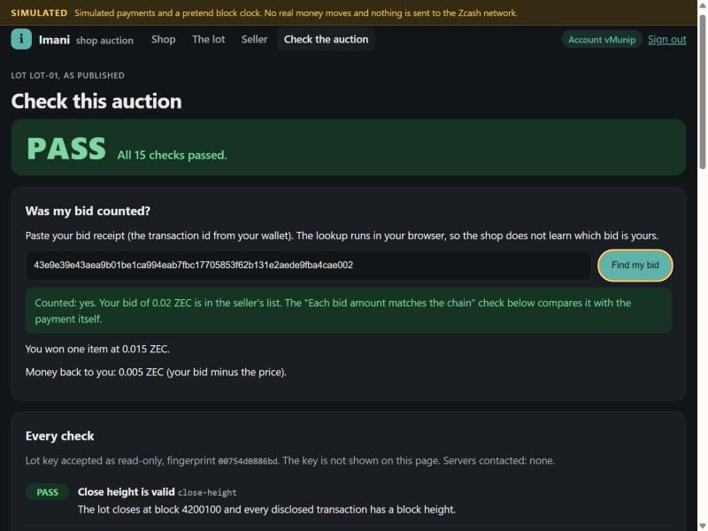
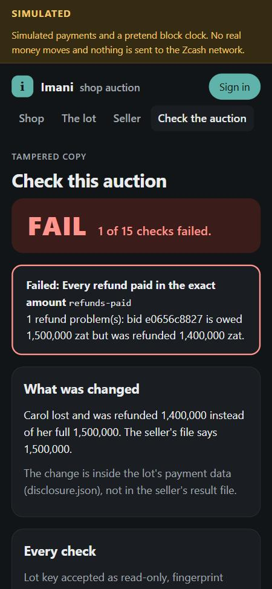

# Imani shop: the demo auction

A small shop that sells one lot (two clay mugs) by sealed bid. You sign in with a private Zcash wallet, bid with a private payment, the seller publishes the result and a one-time lot key, and anyone checks the auction: PASS, or FAIL with the reason named.

It uses the same login kit (`src/login`) and the same checker (`src/check.ts`) as the rest of this repo. No extra packages, no outside scripts, no fonts from elsewhere, no analytics.




## Run it

Install once, then start it:

```sh
npm install
npm run demo:app
```

Open http://localhost:8787 (if that port is taken, the demo picks a free one and prints the address to open). No wallet and no internet needed.

This starts **simulated mode**. A yellow SIMULATED banner stays at the top of every page. Payments go to a pretend network inside the app, the block clock is pretend, and nothing is sent anywhere. The lot replays the recorded test round in `examples/round-01`, so your bid is bid 2 of that round (0.02 ZEC, memo `bid:LOT-01:m3x8`) and the published files match it exactly.

Tests:

```sh
npm run test:demo
```

## Try it in this order

1. **Sign in.** Make your account key (it stays in the browser tab), save the backup file, get a one-time code, then press "Pay from wallet address 1". Then "Sign in again from a new wallet address" and pay from the second address. Same account.
2. **The lot.** Make your bid link and press "Send bid". Keep the receipt it shows.
3. **Seller.** See the bids the seller can read live (a known limit), skip the pretend clock past the close, then publish the result and the lot key.
4. **Check the auction.** Press "Check this auction": PASS. Paste your receipt into "Was my bid counted?". Then go back and "Try a tampered copy": FAIL, with the failed check named.

"Restart the demo" in the footer puts everything back.

## Live mode

```sh
npm run demo:app -- --live
```

Live mode reads real payments through `src/fetch` (two servers run by different people must return the same bytes). It will not start without these settings, and it never falls back to fake data:

| Setting | What it is |
|---|---|
| `IMANI_LOGIN_ADDRESS` | The shop's own shielded or unified address, used only for sign-in payments |
| `IMANI_LOGIN_UFVK` | The read-only viewing key for that address (`uview1...` or `uviewtest1...`). Never a spending key |
| `IMANI_SESSION_SECRET` | A random secret, at least 32 characters |
| `IMANI_SITE_ID` | The site's host name as users see it (default `localhost:<port>`) |
| `IMANI_SERVERS` | Optional. Comma-separated light servers, for example `https://zec.rocks:443` |
| `IMANI_PROXY` | Optional. SOCKS5 proxy such as `socks5h://127.0.0.1:9050`, so servers do not see your internet address |
| `IMANI_LOT_DIR` | Optional. Folder with `lot.json` (lotId, title, address, network, closeHeight, itemCount, reserveZat), and after the close the seller's `disclosure.json` and `result.json` |
| `IMANI_PORT` | Optional. Default 8787. If you set it (or pass `--port <n>`) and it is taken, the demo stops with a message instead of switching |

In live mode the user pays the sign-in link from a real wallet, then pastes the transaction id. If no server answers or the payment is not there yet, the page says so, lists the servers it contacted, and does not sign anyone in. Live mode has been tested with a server that refuses to answer, not yet with a real payment.

## What stays private

| Item | Where it goes |
|---|---|
| Your account key | Made in the browser with Web Crypto (Ed25519). Kept in that tab's memory only. Never sent, never in a web address, never in browser storage. The backup file is made in the browser |
| Your wallet address and balance | Never reach the shop. The pretend wallet sends only the payment |
| The lot key | Stays on the shop's computer until the seller publishes. It leaves only inside the published `disclosure.json` download. Never in a page, web address, cookie or log line |
| Logs | Method, path and status only, plus event names such as `login: login_ok` |

The tests check all of this: every response, header, web address and log line from a full run is scanned for the keys.

Without JavaScript, every page and form still works except sign-in, which says why it needs it.

## Shot list for the 2-minute video

Record in simulated mode first. Keep the SIMULATED banner in frame. Use a clean browser profile, no other tabs.

| Time | Screen | Action |
|---|---|---|
| 0:00 to 0:12 | Shop home | Show the headline, the four steps and the lot card |
| 0:12 to 0:35 | Sign in | Make the account key, get the code, "Pay from wallet address 1". Hold on "This shop learned: account ... Nothing else." |
| 0:35 to 0:52 | Sign in | "Sign in again from a new wallet address", pay from the new address. Hold on "Same account as before" |
| 0:52 to 1:08 | The lot, then Seller | Make the bid link, send the bid, show the receipt. On Seller, skip the clock and press "Publish the result and the lot key" |
| 1:08 to 1:30 | Check the auction | "Check this auction": the PASS box. Paste the receipt into "Was my bid counted?" |
| 1:30 to 1:45 | Check the auction | "Try a tampered copy" with Carol's short refund. Hold on FAIL and the named check `refunds-paid` |
| 1:45 to 1:58 | Shop home | Scroll to "Honest limits" |

## Honest limits of this demo

- Simulated mode replays one recorded round (`examples/memo-01`), so the bid amount, memo word and refund address are fixed. The lot page shows the refund address field; in live mode the bidder pastes a fresh address of their own. A new amount needs a new round built with the tools in `tools/gen-vectors`.
- The simulated sign-in uses the real login kit check on pretend payment bytes. The real decoder is used for the lot (seller's view and the check), not for the simulated sign-in.
- There is no QR code. The page shows the payment link and an "Open in my wallet" button.
- The seller's page is open to everyone so one person can play both sides.
