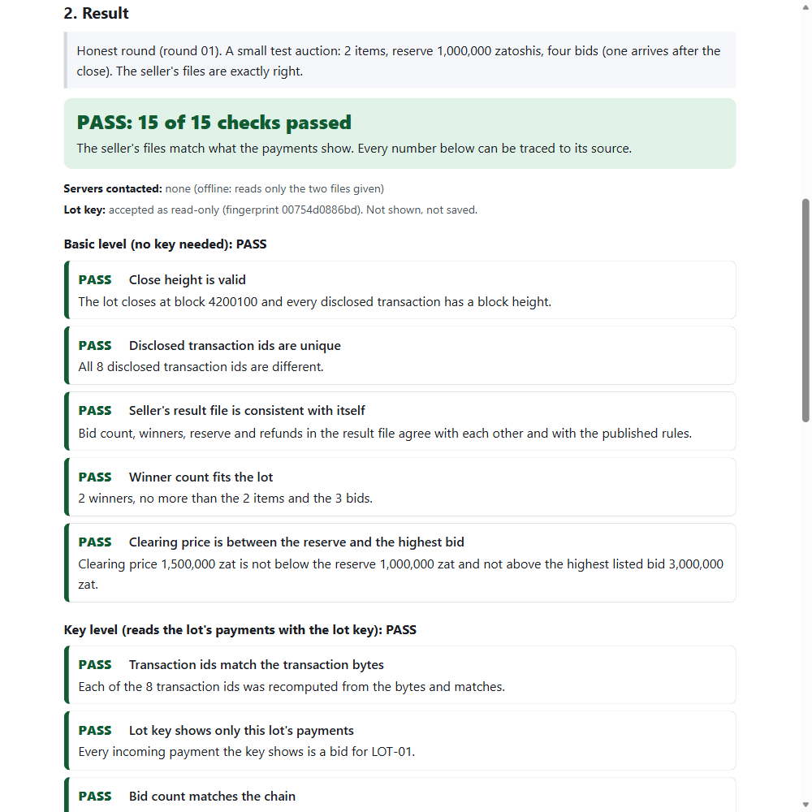
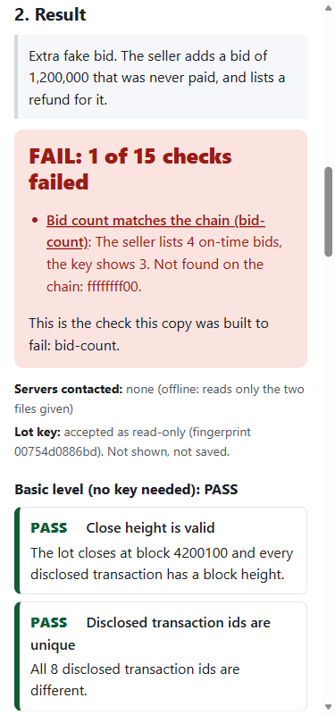

# Imani in the browser: the checker page that uploads nothing

A static web page that runs the Imani auction checker inside the visitor's browser. It opens on the bundled example round 01 with no input and shows PASS (15 of 15 checks). A visitor can switch to six tampered copies, three scan examples, or drop in their own disclosure and result files. Nothing is uploaded, and the page makes no network calls after it loads.




## What the page does

| Part | What it shows |
|---|---|
| Opens on | Round 01, honest, PASS with 15 of 15 checks |
| "Try a tampered copy" | Loads each of the 6 broken copies in turn (`examples/broken`), FAIL with the failed check named and the reason |
| Scan examples | `examples/scan-01` (PASS, 20 of 20) and the 3 copies in `examples/scan-broken` (each fails one named scan check) |
| Your own files | Drop a disclosure file, a result file and optionally a chain file (adds the scan) and a bidder keys file. The page tells them apart by their `format` field |
| Discreet mode | A checkbox that hides amounts and memos, the same as `--discreet` on the command line |
| Refusals | Spending keys, seed phrases, incoming-only keys and keys for the wrong network are refused with the same messages as the command line. The lot key is never shown |
| "Servers contacted: none" | Shown at the top and again in each result |
| Where numbers come from | Every check lists what came from the chain (read with the lot key), from the seller's result file, and from the disclosure file. A legend explains the three |
| Honest limits | The checker only works when the seller shares the lot's one-time viewing key, the seller can see bids as they arrive, and it is not a zero-knowledge proof |

## Build it

```sh
npm install
npm run site:build     # writes site/ (app.js, index.html, style.css, SHA256SUMS)
npm run site:serve     # serves site/ at http://127.0.0.1:8788/
npm run test:site      # offline tests
```

`site/` is not committed. It is made from the sources in `src/site/` and the files in `vendor/decoder/` and `examples/`.

## How the decoder runs in the browser

The reader is the same WebAssembly file the command line tool uses, `vendor/decoder/imani_decoder_bg.wasm`. It was not rebuilt, so no Rust is needed.

1. The vendored glue file (`imani_decoder.js`) is made for Node: its last lines read the wasm from disk. The build checks that those lines are exactly what it expects, swaps them for a loader that instantiates the wasm from bytes, and wraps the result as a module.
2. The wasm bytes are embedded in `app.js` as base64, so the page does not need to download anything after it loads, and it also works when opened from disk.
3. The build refuses to run if any file in `vendor/decoder/` does not match `SHA256SUMS`. A test checks that the bytes inside `app.js` hash to the wasm line in `SHA256SUMS`, and the page prints that hash at the bottom.
4. `src/check.ts`, `src/scan/*`, `src/rules.ts` and `src/report.ts` are bundled unchanged. Only `src/read.ts` is swapped for `src/site/read-browser.ts`, and `node:crypto` for a small SHA-256 (`src/site/crypto-shim.ts`, tested against Node's).

If the decoder is ever rebuilt and its Node loader changes, the build stops with a message instead of producing a broken page.

## Host it on GitHub Pages

The built folder is plain static files with relative paths, so any static host works. For GitHub Pages, publish the `site/` folder from a workflow, for example:

```yaml
name: Pages
on: { push: { branches: [main] } }
permissions: { pages: write, id-token: write, contents: read }
jobs:
  deploy:
    runs-on: ubuntu-latest
    environment: { name: github-pages }
    steps:
      - uses: actions/checkout@v4
      - uses: actions/setup-node@v4
        with: { node-version: 22 }
      - run: npm ci
      - run: npm run site:build
      - uses: actions/upload-pages-artifact@v3
        with: { path: site }
      - uses: actions/deploy-pages@v4
```

The page has a content security policy in its HTML (`connect-src 'none'`), so the browser itself blocks any network call from the page. GitHub Pages cannot add headers, which is why the policy is set in the page.

## How it was verified

| Check | Result |
|---|---|
| `npm run test:site` (offline) | The page logic, built the same way as the page (browser reader, pure JavaScript SHA-256), gives the same verdict as the command line for round 01 (also with `--discreet`), all 6 broken copies, `scan-01` and the 3 scan copies, each failing exactly its named check |
| No network in the bundle | Test scans the built `app.js` for fetch, XMLHttpRequest, WebSocket, sendBeacon, EventSource, dynamic import, workers, storage and any web address, and checks the page's security policy and that it loads only `app.js` and `style.css` |
| No network at run time | Test traps fetch, XMLHttpRequest, WebSocket, EventSource, http, https and net, runs every example, and asserts none was called |
| Refusals | Test feeds a spending key, a seed phrase and an incoming-only key, and checks the answer is a refusal that does not repeat them |
| Real browser | The built page was served locally and opened in a browser: round 01 shows PASS 15 of 15, a tampered copy shows FAIL 1 of 15 with `bid-count` named, `scan-01` shows PASS 20 of 20, the hidden-bid scan copy fails `scan-hidden-bids`. At 375 px wide there is no sideways scroll. The browser console had no messages. The network list held only `index.html`, `style.css` and `app.js` |

## Limits

- The page contains the example files, so `app.js` is about 2.6 MB (about 1 MB when the host compresses it).
- The hosted page cannot download blocks. The full scan works from a chain file you give it. To fetch blocks from public servers, use the command line with `--scan --fetch`.
- The page is only as trustworthy as the copy you load. To avoid trusting a host, build it yourself, or use the command line tool offline.
